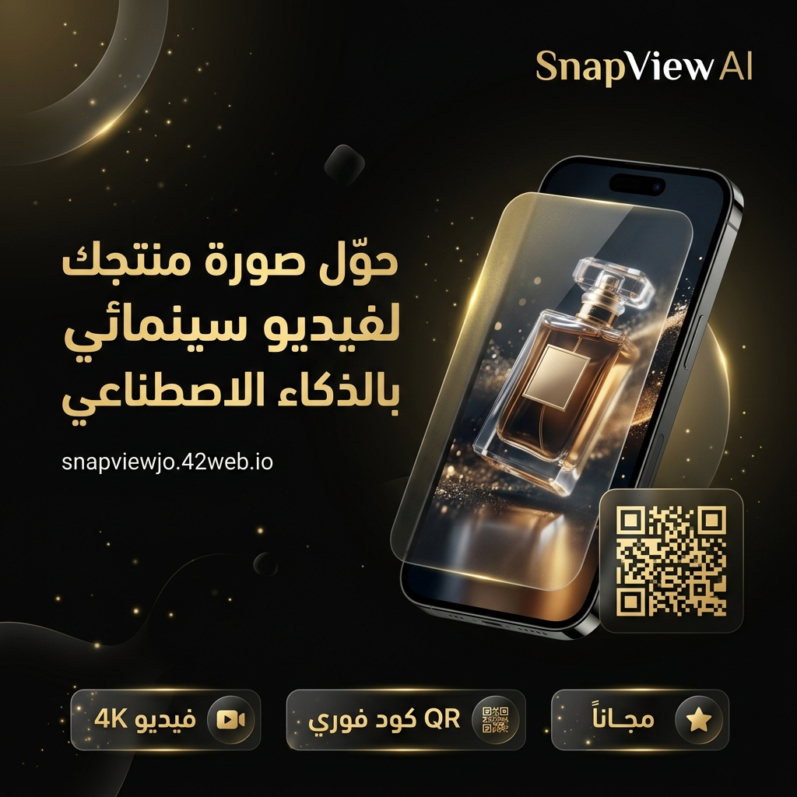
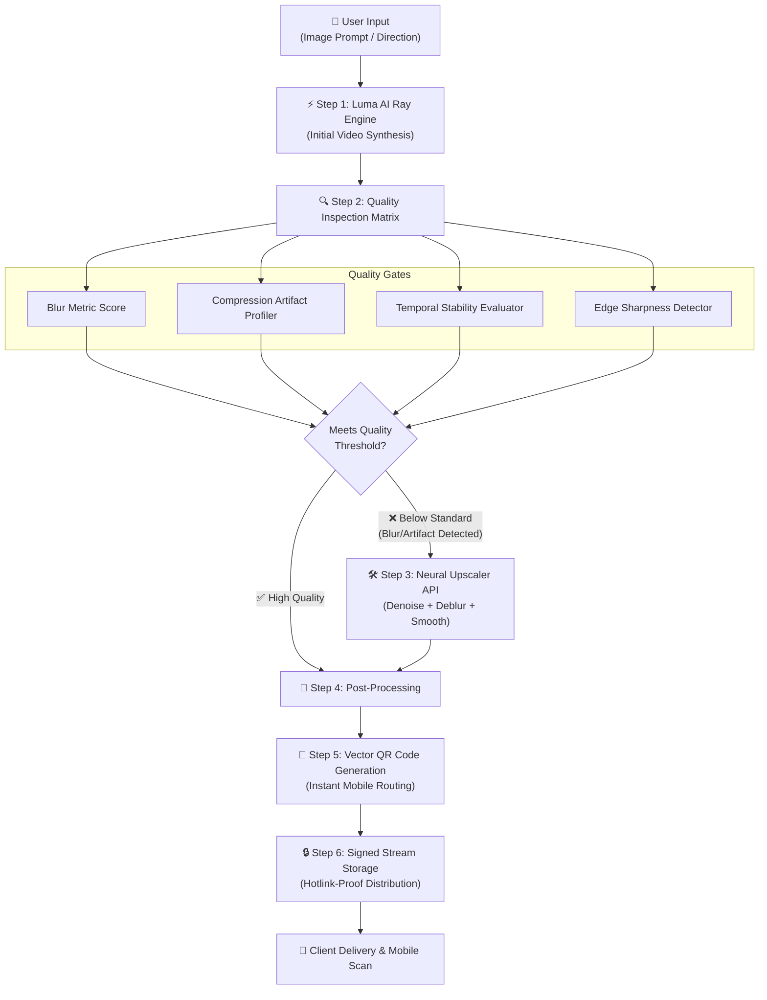

<div align="center">

  

  # 🎬 SnapView
  ### *Intelligent AI Video Synthesis & Dynamic QR Mobile Showcase Platform*

  <p align="center">
    <strong>A next-generation commercial SaaS bridging high-fidelity generative AI video models with real-world mobile AR/3D instant preview.</strong>
  </p>

  <!-- Badges Grid -->
  <p align="center">
    <a href="https://snapviewjo.42web.io/?i=1"></a>
    
    
    
    
    
    
  </p>

  <!-- Quick Nav -->
  <p align="center">
    <a href="#-interactive-live-demo">🚀 <b>Live Demo</b></a> •
    <a href="#-project-overview">💡 <b>Overview</b></a> •
    <a href="#-multi-phase-ai-pipeline">🧠 <b>AI Pipeline</b></a> •
    <a href="#-key-capabilities">✨ <b>Key Features</b></a> •
    <a href="#%EF%B8%8F-technology-stack">🛠️ <b>Tech Stack</b></a> •
    <a href="#-mobile-qr-experience">📱 <b>QR Experience</b></a> •
    <a href="#-developer--contact">📬 <b>Author</b></a>
  </p>

  <br/>

  <!-- Hero Visual -->
  

</div>

---

> [!IMPORTANT]
> ### 🛡️ Commercial Software & Closed-Source Intellectual Property Notice
> **SnapView is a proprietary commercial SaaS product.** To safeguard business logic, neural scoring algorithms, and proprietary video optimization pipelines, the production source code is maintained in an enterprise private repository.
> 
> **This public repository is the official Portfolio Showcase & Architectural Reference.** You are warmly invited to test and interact with the full production application directly on the **[Live Demo](#-interactive-live-demo)**.

---

## 🚀 Interactive Live Demo

Experience the live, deployed environment of SnapView in real-time:

<div align="center">

### 🔗 **[https://snapviewjo.42web.io/?i=1](https://snapviewjo.42web.io/?i=1)**

[](https://snapviewjo.42web.io/?i=1)

*💡 **Guest Access Supported:** Experience instant video rendering, status checks, and scan generated QR codes directly from any mobile device without mandatory signup.*

</div>

---

## 💡 Project Overview

### 🎯 The Challenge
Generative video engines (like Luma AI, Runway, Sora) produce stunning clips but suffer from two major operational hurdles in real-world business use:
1. **Unpredictable Artifacts:** Motion blur, temporal tearing, and frame degradation frequently occur during synthesis, wasting credits and manual review time.
2. **Distribution Friction:** Sharing heavy video files between desktop workstations and mobile clients requires cumbersome downloads or third-party cloud drives.

### 🌟 The SnapView Solution
**SnapView** delivers an autonomous, end-to-end platform combining AI synthesis, quality assurance, and physical-to-digital QR distribution:

- **🧠 Automated Quality Telemetry:** A mathematical 6-phase scoring stage inspects generated video frames for blur, edge degradation, and compression noise. If thresholds are breached, SnapView automatically dispatches neural upscaling to repair the video before delivery.
- **📲 Zero-Friction QR Mobile Preview:** Every render compiles a high-density, vector QR code linked to a signed, guest-accessible mobile 3D playback canvas. Anyone with a smartphone camera can view the scene within 2 seconds.
- **💼 Complete Monetization Infrastructure:** Full subscription package management, promo coupon engine, bank transfer receipt auditing, and custom 2-Factor Authentication for administrative control.

---

## 🧠 Multi-Phase AI Pipeline

SnapView does not simply proxy API calls; it manages an intelligent, self-healing pipeline:



---

## ✨ Key Capabilities

<table>
  <tr>
    <td width="50%">
      <h3>🎬 Cinematic AI Video Synthesis</h3>
      <ul>
        <li>Native integration with <b>Luma AI Ray & Dream Machine</b> APIs.</li>
        <li>Image-to-video motion interpolation with configurable camera paths.</li>
        <li>Asynchronous polling workers ensuring zero web-server timeouts.</li>
      </ul>
    </td>
    <td width="50%">
      <h3>📈 Dynamic Autonomous Upscaling</h3>
      <ul>
        <li>Calculates <b>Blur, Artifact, and Temporal Flicker scores</b>.</li>
        <li>Dynamically triggers neural upscaling only when strictly required.</li>
        <li>Saves up to <b>60% in GPU overhead</b> by skipping clean generations.</li>
      </ul>
    </td>
  </tr>
  <tr>
    <td width="50%">
      <h3>📱 Vector QR Code & Mobile 3D Player</h3>
      <ul>
        <li>Generates high-contrast, scalable SVG/PNG QR codes on the fly.</li>
        <li>Standalone mobile viewing player tailored for instant smartphone scanning.</li>
        <li>No app installation or account required for guest viewers.</li>
      </ul>
    </td>
    <td width="50%">
      <h3>🛡️ Enterprise Security & 2FA Admin</h3>
      <ul>
        <li>Cryptographic <b>Time-Limited Signed URLs</b> to thwart hotlinking.</li>
        <li>Email-based <b>Two-Factor Authentication (2FA)</b> for sensitive panels.</li>
        <li>Secure payment receipt uploads and manual financial approval workflows.</li>
      </ul>
    </td>
  </tr>
</table>

---

## 🛠️ Technology Stack

```
               ┌────────────────────────────────────────────────────────┐
               │                     USER INTERFACE                     │
               │   Blade Templates • Tailwind CSS 3 • Alpine.js • Vite  │
               └───────────────────────────┬────────────────────────────┘
                                           │ HTTP / AJAX
               ┌───────────────────────────▼────────────────────────────┐
               │                    APPLICATION CORE                    │
               │              Laravel 12.x  •  PHP 8.2+                 │
               │      Eloquent ORM • Breeze Auth • Socialite (OAuth)    │
               └─────────────┬───────────────────────────┬──────────────┘
                             │                           │
          ┌──────────────────▼──────────┐     ┌──────────▼───────────────┐
          │      AI & MEDIA ENGINE      │     │    DATABASE & STORAGE    │
          │   Luma AI Generation API    │     │       MySQL 8.0          │
          │   Luma Neural Upscale API   │     │    Signed File Storage   │
          │   Simple QRCode Vector Gen  │     │   Excel / Receipt Audits │
          └─────────────────────────────┘     └──────────────────────────┘
```

| Domain | Technology | Purpose |
| :--- | :--- | :--- |
| **Backend** | **Laravel 12.x (PHP 8.2+)** | Core architectural framework, queues, API handling |
| **Frontend** | **Tailwind CSS + Alpine.js** | Responsive, dark-mode ready, glassmorphic UI |
| **AI Synthesis** | **Luma AI Ray API** | Generating high-fidelity cinematic video scenes |
| **Enhancement** | **Luma Dynamic Upscale API** | Neural deblurring, temporal stabilization, artifact cleaning |
| **QR Generation** | **SimpleSoftwareIO QRCode** | Instant mobile scannable vectors |
| **Authentication** | **Laravel Breeze + Socialite** | Google OAuth & email identity systems |
| **Security** | **Two-Factor Auth (2FA) + Signed URLs** | Defense-in-depth for media streaming and administration |
| **Database** | **MySQL** | Relational store for users, payments, quotas, and logs |

---

## 📱 Mobile QR Experience

<div align="center">

```
  ┌─────────────────┐       Instant Camera Scan       ┌────────────────────────┐
  │  Generated QR   │    ────────────────────────►    │  Responsive 3D Viewer  │
  │  on Web Screen  │                                 │  on Mobile Browser     │
  └─────────────────┘                                 └────────────────────────┘
```

Try scanning or clicking directly on the live link to witness how seamless video sharing is:
👉 **[Open Live Demo Portal](https://snapviewjo.42web.io/?i=1)**

</div>

---

## 📂 Showcase Repository Architecture

```
snapview-showcase/
├── assets/
│   ├── logo.png             # Official brand vector & icon
│   └── og-snapview.jpg      # High-resolution platform preview banner
├── README.md                # Comprehensive architectural showcase (This document)
└── LICENSE                  # Proprietary closed-source commercial license
```

---

## 📬 Developer & Contact

Developed and maintained by **Hamzah Rababah**.

<p align="left">
  <a href="https://github.com/HamzahRababah707"></a>
  <a href="https://snapviewjo.42web.io/?i=1"></a>
  <a href="mailto:rababahhamzah@gmail.com"></a>
</p>

- **GitHub Profile:** [@HamzahRababah707](https://github.com/HamzahRababah707)
- **Live Demo:** [https://snapviewjo.42web.io/?i=1](https://snapviewjo.42web.io/?i=1)
- **Email:** `rababahhamzah@gmail.com`

---

<div align="center">

<sub>Copyright © 2026 SnapView by Hamzah Rababah. All rights reserved. Commercial closed-source software.</sub>

</div>
