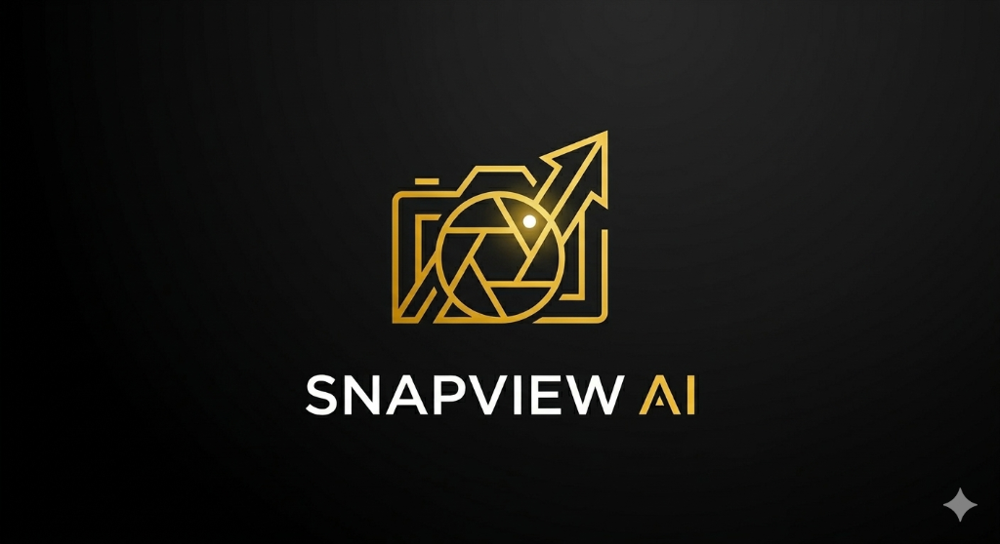
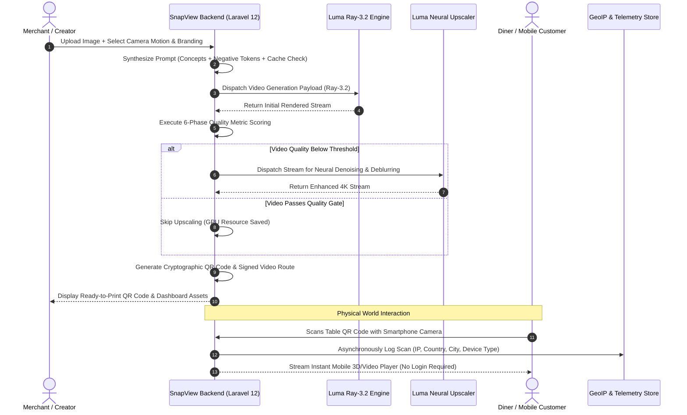

<div align="center">

  

  # 🎬 SnapView
  ### *Enterprise AI Video Synthesis & Dynamic QR Telemetry Platform*
  **Next-Generation Visual Commerce for Interactive Hospitality Menus & 3D Product Showcases**

  <br/>

  <!-- Shields Badges Matrix -->
  <p align="center">
    <a href="https://snapviewjo.42web.io/?i=1"></a>
    
    
    
    
    
    
  </p>

  <!-- Navigation Bar -->
  <p align="center">
    <a href="#-interactive-live-demo">🚀 <b>Live Demo</b></a> •
    <a href="#-executive-summary">💡 <b>Executive Summary</b></a> •
    <a href="#-architectural-innovations">🧠 <b>Core Innovations</b></a> •
    <a href="#-system-sequence--telemetry-flow">🔄 <b>Lifecycle Flow</b></a> •
    <a href="#%EF%B8%8F-production-tech-stack">🛠️ <b>Tech Stack</b></a> •
    <a href="#-security--anti-fraud-architecture">🛡️ <b>Security & Anti-Fraud</b></a> •
    <a href="#-author--contact">📬 <b>Author</b></a>
  </p>

  <br/>

  <!-- High-Resolution Platform Banner -->
  

</div>

---

> [!IMPORTANT]
> ### 🔒 Commercial Intellectual Property & Portfolio Showcase Notice
> **SnapView is a proprietary commercial SaaS platform.** The underlying production codebase, neural scoring heuristics, automated prompt caching algorithms, and anti-fraud financial pipelines are maintained in an enterprise private repository to safeguard core intellectual property.
> 
> **This public repository serves as the official Architectural Reference and Technical Portfolio.** Recruiters, investors, and technical teams are invited to test the live production system directly via the **[Live Demo](#-interactive-live-demo)**.

---

## 🚀 Interactive Live Demo

Experience **SnapView** in action through the deployed production environment:

<div align="center">

### 🔗 **[https://snapviewjo.42web.io/?i=1](https://snapviewjo.42web.io/?i=1)**

[](https://snapviewjo.42web.io/?i=1)

</div>

| Experience Mode | Capability | Access Level |
| :--- | :--- | :--- |
| **🖥️ Creator Studio** | Generate AI videos, configure camera motions, test upscale triggers | Authenticated / Guest Preview |
| **📱 Mobile QR Gateway** | Scan generated QR codes via native smartphone camera for instant 3D view | Zero-login Guest Streaming |
| **🛡️ Management Console** | Payment verification, promo coupon authoring, package tier controls | Protected by Two-Factor Auth (2FA) |

---

## 💡 Executive Summary

### The Industry Problem
- **In Hospitality & Food Services:** Printed physical menus and flat 2D images fail to evoke appetite appeal, while static PDF menus offer poor mobile interactivity.
- **In Visual E-Commerce & Retail:** Generating photorealistic 3D product videos requires expensive 3D artists or studio videography.
- **In Generative AI Pipelines:** Raw AI video synthesis (Luma, Runway, Sora) often produces stochastic defects—such as motion blur, temporal flickering, and structural artifacts—wasting expensive GPU credits.

### The SnapView Solution
**SnapView** delivers an autonomous visual commerce infrastructure:
1. **White-Label Interactive Menus:** Restaurants and brands can generate cinematic videos for their dishes and merchandise, branded with custom colors, logos, and business names (`restaurant_name`, `theme_color`, `custom_logo`).
2. **Autonomous Quality Self-Healing:** Generative outputs undergo mathematical quality evaluation. Videos that breach noise or blur thresholds are automatically repaired via neural upscaling, slashing defective outputs to near zero.
3. **Physical-to-Digital Handshake with Telemetry:** High-contrast vector QR codes placed on physical dining tables or product packaging instantly route guests to an ultra-fast standalone 3D player while capturing real-time geolocation analytics.

---

## 🧠 Architectural Innovations

### 1. 🔍 Autonomous 6-Phase Dynamic Quality Upscaler
Rather than blindly dispatching every video to expensive enhancement APIs, SnapView employs a cost-saving telemetry pipeline:

```
[Video Generation] ──► [Quality Scoring Engine] ──► Threshold Evaluation
                              ├─ Blur Score Check            ├──► Meets Standard (>90) ──► Skip to QR Gen (Save GPU Cost)
                              ├─ Artifact Profiler           └──► Defects Detected    ──► Trigger Luma Upscale API
                              ├─ Edge Sharpness Analysis                                      (Deblur + Denoise + Smooth)
                              └─ Temporal Flicker Metric
```
- **Cost Reduction:** Achieves up to **60% GPU cost savings** by upscaling only frames that mathematically require reconstruction.
- **Fail-Safe Thresholds:** Configured via runtime environment variables (`LUMA_UPSCALE_BLUR_THRESHOLD`, `ARTIFACT_THRESHOLD`).

---

### 2. ⚡ Motion-Aware Prompt Synthesizer & Historical Prompt Caching
SnapView’s engine (`LumaController`) implements an intelligent prompt construction layer powered by the **Luma Ray-3.2** foundation model:
- **Spatial Concept Injection:** Maps frontend UI controls into 3D camera trajectory keys (`dolly-in`, `orbit`, `pan`, `zoom`) and injects them into Luma's native `concepts` vector payload.
- **Negative Prompt Sanitization:** Automatically appends defense tokens (`morphing`, `distortion`, `flickering`, `sudden transformation`) to lock object geometry and maintain product branding integrity.
- **Intelligent Prompt Caching:** Queries historical successful generations (`quality_score > 90` within the past 7 days). If a high-scoring prompt template for a product type exists, SnapView reuses the proven motion architecture to ensure deterministic, high-quality visual results.

---

### 3. 📱 Physical QR Generation & Standalone Guest 3D Viewer
- **Vector Scalability:** Compiles high-density, error-corrected QR codes (`simple-qrcode`) suitable for high-resolution table tent printing or digital display.
- **Zero-Friction Mobile Playback:** Routes to a lightweight standalone route (`/view/{id}`) engineered for instant mobile browser rendering—eliminating the need for mobile app downloads or user authentication.

---

### 4. 📊 Real-Time GeoIP & Device Telemetry Engine (`QrScan`)
Every scan of a SnapView QR code triggers an asynchronous telemetry pipeline:
- **Captured Metrics:** Logs `ip_address`, `country`, `city`, `device` (Mobile/Desktop/Tablet), and precise UTC timestamps.
- **Business Intelligence:** Venue operators and merchants gain real-time insight into which physical dining tables, promotional displays, or retail campaigns generate the highest customer engagement.

---

### 5. 🛡️ Anti-Fraud & Transaction Integrity Subsystem (`FraudAttempt`)
To protect against payment fraud in manual bank transfers and receipt submissions:
- **Deduplication Guardian:** Audits unique transaction references (`bank_reference`). Duplicate submissions instantly trigger security containment.
- **Automated Fraud Logging:** Malicious attempts are flagged in `fraud_attempts` recording user ID, IP address, sender phone number, and transaction context for immediate administrative review.

---

### 6. 🩺 Self-Healing Diagnostics Subsystem (`DiagnosticsController`)
SnapView includes an integrated operational health monitor:
- Verifies public storage disk read/write accessibility.
- Checks live HTTP handshake latency with Luma AI API endpoints.
- Validates queue worker heartbeats and background job latency.

---

## 🔄 System Sequence & Telemetry Flow

The following sequence details how SnapView orchestrates creation, self-healing upscaling, and real-time QR telemetry:



---

## 🛠️ Production Tech Stack

| Architectural Layer | Technologies & Ecosystem | Role & Implementation |
| :--- | :--- | :--- |
| **Backend Core** | **Laravel 12.x** (PHP 8.2+) | MVC architecture, Eloquent ORM, custom Artisan tools |
| **Frontend UI** | **Tailwind CSS 3 + Alpine.js + Vite** | Responsive, dark-mode ready glassmorphic interfaces |
| **AI Foundation Model** | **Luma AI Ray-3.2 Engine** | High-fidelity image-to-video motion synthesis |
| **Quality Enhancement** | **Luma Neural Upscale API** | Multi-phase dynamic deblurring and artifact mitigation |
| **Physical-Digital Bridge**| **SimpleSoftwareIO Simple QRCode** | Dynamic vector (SVG/PNG) QR code generation |
| **Telemetry & Analytics** | **GeoIP Services + QrScan Model** | Scan origin tracking (Country, City, User-Agent) |
| **Security & Auth** | **Laravel Breeze + Socialite (Google)**| OAuth 2.0 integration and role-based access control |
| **Admin Protection** | **Custom Two-Step Verification (2FA)** | 6-digit email OTP for critical administrative gates |
| **Integrity & Auditing** | **FraudAttempt Model + Signed URLs** | Deduplication of bank references & hotlink protection |
| **Data Persistence** | **MySQL 8.0** | Relational schemas for users, models, scans, and coupons |

---

## 🛡️ Security & Anti-Fraud Architecture

<div align="center">

```
  ┌───────────────────────┐       ┌───────────────────────┐       ┌───────────────────────┐
  │  Signed Stream URLs   │       │   Admin 2FA Gateway   │       │ Anti-Fraud Inspector  │
  │  (Auto-Expiring Keys) │       │   (6-Digit Email OTP) │       │ (Bank Ref Deduplication)
  └───────────────────────┘       └───────────────────────┘       └───────────────────────┘
```

</div>

- **Cryptographically Signed Routes:** Video streams are served via `URL::signedRoute` with strict time-to-live (TTL) limits, preventing bandwidth theft, unauthorized hotlinking, and content scraping.
- **Two-Factor Administrative Barrier:** Access to package price overrides, coupon management, and financial payment approvals is fortified with multi-factor email verification.
- **Financial Audit Logging:** Complete audit trail tracking user IDs, sender phone numbers, and IP addresses for every transaction request.

---

## 📂 Showcase Repository Blueprint

```
snapview-showcase/
├── assets/
│   ├── logo.png               # Official brand identity vector
│   └── og-snapview.jpg        # High-resolution platform preview banner
├── README.md                  # Comprehensive architectural reference (This document)
└── LICENSE                    # Proprietary closed-source commercial license
```

---

## 📬 Author & Contact

Architected and developed by **Hamzah Rababah**.

<p align="left">
  <a href="https://github.com/HamzahRababah707"></a>
  <a href="https://snapviewjo.42web.io/?i=1"></a>
  <a href="mailto:rababahhamzah64@gmail.com"></a>
</p>

- **GitHub Profile:** [@HamzahRababah707](https://github.com/HamzahRababah707)
- **Production URL:** [https://snapviewjo.42web.io/?i=1](https://snapviewjo.42web.io/?i=1)
- **Direct Email:** `rababahhamzah64@gmail.com`

---

<div align="center">

<sub>Copyright © 2026 SnapView by Hamzah Rababah. All rights reserved. Commercial closed-source software.</sub>

</div>
